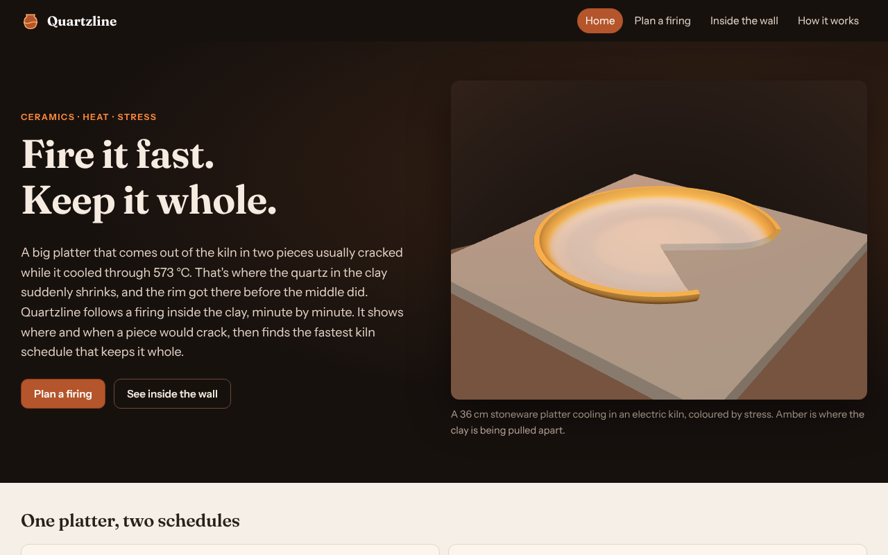
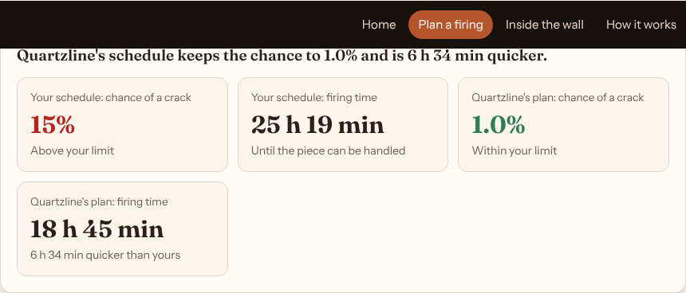
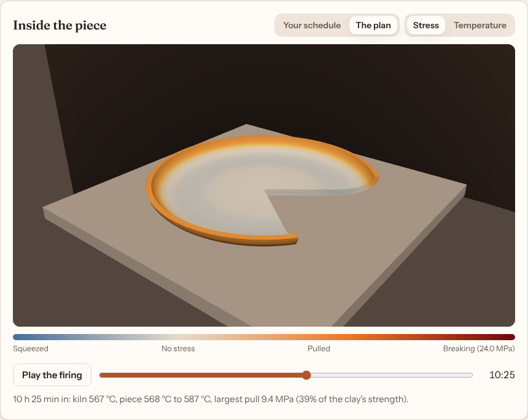
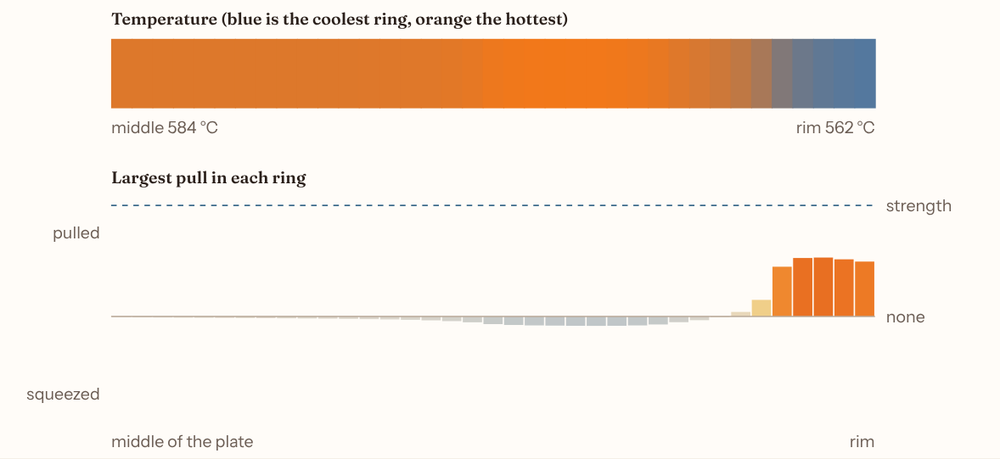
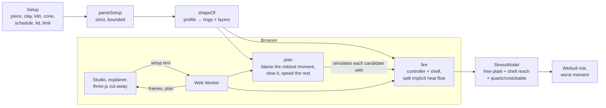

# Quartzline

**Fire it fast. Keep it whole.** A kiln-firing simulator that shows where and when a pot would crack, and plans the fastest schedule that keeps it in one piece.

[](https://github.com/reihooneh/quartzline/actions/workflows/ci.yml)


**Live:** https://reihooneh.github.io/quartzline/

Quartzline follows a firing inside the clay, minute by minute. Heat flows from the kiln into every ring of the pot's wall; uneven heat becomes stress; and the stress on every bit of clay becomes a chance of cracking. It shows the worst moment (where, when and why). Then it searches for the fastest kiln schedule that keeps that chance under your limit, written out for your kiln's controller.



## Why I built this

A big platter that comes out of the kiln in two pieces most likely cracked while cooling through 573 °C, where the quartz in the clay suddenly shrinks. Potters call it a *dunt*. Everyone has a rule of thumb ("cool slowly through quartz", "don't open above 100 °C", "fire big plates slower"). But nobody can say how slowly, for this piece, in this clay and this kiln. Being too cautious costs hours on every firing; not cautious enough costs the piece.

The tools I found are kiln controllers, firing logs and glaze calculators. None simulates what's happening inside the clay. Quartzline brings the engineering methods used for thermal stress in refractories and glass (heat conduction, plate and shell theory, Weibull statistics) to a single pot. It runs in a browser in a second or so.

## Features

- **Heat, ring by ring:**
  - a turned pot is described by its profile, and cut into up to 60 rings, each wall into 6 layers;
  - heat reaches it by radiation and convection, the inside only as much as it can see out of the opening;
  - the base rests on a shelf that lags behind the kiln;
  - opening the lid lets in room air while the walls stay hot.
- **Stress:**
  - across the wall, the free-plate result: only the part of the temperature profile that isn't a straight line causes stress;
  - along the pot, each ring is held by its neighbours within the shell's reach of 2.4·√(R·h). This form is exact for a flat disc.
  - Quartz (573 °C) and cristobalite (about 226 °C) add sudden steps to the expansion curve.
- **Crack chance:** a Weibull model turns the pull on every bit of clay into a probability. The report gives the riskiest moment in words, for example: *"10 h 27 min in, while the kiln was cooling at 565 °C, the largest pull was 9.6 MPa at the rim (outside face)."*
- **A planner:**
  - a schedule is eight choices (three heating rates, four cooling rates, and when to open the lid), each with a ladder of settings;
  - it starts flat out, finds the riskiest moment, and slows whichever choice was in charge then (judged by the temperature range the pot itself was passing through);
  - then it speeds everything else back up;
  - on two choices at a time it matches exhaustive search in the tests;
  - the result downloads as controller segments.
- **Four pages:**
  - the studio, with a 3D cut-away pot coloured cell by cell by stress or temperature, played through the firing, plus the firing chart and the plan;
  - an *Inside the wall* explainer (a plate cooling through quartz, with your own diameter, thickness, clay and rate);
  - a method page whose checks against exact solutions run live in your browser;
  - the home page.

| The planner's verdict | Inside the piece: a cut-away platter coloured by stress |
|---|---|
|  |  |



## Architecture



## The example, in numbers

A 36 cm stoneware platter (9 mm base), cone 6 in a studio electric kiln:

| | Chance of a crack | Firing time | Worst moment |
|---|---|---|---|
| The usual "fast glaze" schedule, lid shut until cool | **15%** | 25 h 19 min | the rim, cooling through quartz |
| Quartzline's plan | **1.0%** | **18 h 45 min** | the rim, cooling through quartz |

The plan:
- heats as fast as the kiln can (cracks on heating are rare for bisqued ware);
- cools at 60 °C/h from 700 to 500 °C, so the middle keeps up with the rim through quartz;
- opens the lid at 200 °C.

It is safer *and* 6½ hours quicker, because the hours go where the risk is.

## Stack

- **Engine:** TypeScript (strict), no dependencies. It runs in a Web Worker, and also in Node for the tests.
- **Site:** plain ES modules, three.js 0.186 (self-hosted), and the Fraunces and Instrument Sans fonts (self-hosted). It has a strict CSP and no framework.
- **Tests:** `node:test` for the engine, and Playwright 1.63 at phone, tablet and desktop sizes.
- **CI:** GitHub Actions runs:
  - the type check;
  - the engine tests;
  - `npm audit`;
  - a byte-for-byte rebuild of the site;
  - the browser tests;
  - then the deploy to GitHub Pages.

## Run it

```bash
npm ci
npm run build                 # tsc, then the pages into site/
npm test                      # engine tests
npm run serve                 # http://127.0.0.1:4173/
npx playwright install chromium && npm run test:web
```

## Tests

- **Exact answers:**
  - heat crossing a slab matches the series solution;
  - steady cooling reproduces the parabolic profile and its surface stress (2/3)·Eα·ΔT/(1−ν);
  - a straight-line strain in a free plate gives zero stress;
  - a flat disc's hoop stress matches the closed-form solution at five radii;
  - an evenly heated pot has no stress.
- **Conservation:** heat in through the faces equals heat stored, to 1e-9, over whole firings.
- **Convergence:** a 5× finer time step changes the stress by under 2%.
- **What potters know:** bigger plates, thicker casseroles, silica-rich clay and fast-cooling kilns all crack more, and flameware less. Opening the lid hot cracks silica-rich clay through cristobalite.
- **The planner:**
  - it meets the limit;
  - on two choices at a time it matches trying every combination (four cases);
  - the largest piece in the slowest kiln stops within its time limit.
- **Hostile files:** prototype pollution, markup, unknown fields, out-of-range and non-finite numbers, wrong types, oversized files. Messages never echo the input.
- **The site:** every page at three sizes, checked for:
  - no console errors, no sideways scrolling, no overlapping text (HTML or SVG) and no overlapping controls;
  - the studio's whole flow, the schedule editor, hostile uploads, the explainer's physics, the live checks, the server's path checks, and every page's CSP.

## Security

See [SECURITY.md](SECURITY.md). In short:

- **Static site:** setups never leave your device.
- **Strict CSP:** no inline code, and nothing from other sites.
- **No HTML from strings:** a test enforces it.
- **Untrusted files:** they are parsed strictly, and checked again in the worker.
- **Bounded work:** every simulation and the planner have limits, and run off the page's thread.
- **Dependencies:** they are pinned and audited, and the build is reproducible.

## Limits and roadmap

**Limits:**
- Clay and kiln properties are typical published values, not measurements of yours.
- Ware is assumed bisqued and dry: drying, steam and burnout aren't modelled.
- Glaze fit, one-sided heating from elements, and draughts aren't modelled.
- The along-the-pot stress is an engineering simplification, exact for a flat disc.
- The planner never suggests opening the lid above 250 °C.

Test any new schedule on pieces you can spare.

**Roadmap:**
- **Calibrate to your clay:** fit strength and cristobalite content from a few test tiles fired at different cooling rates.
- **Draw your own profile:** drag the outline of a piece instead of choosing a form.
- **A loaded kiln:** several pieces and shelves sharing the heat, with element positions.
- **Glaze fit:** add the glaze layer's expansion to predict crazing and shivering.

More detail: [HOW-IT-WORKS.md](HOW-IT-WORKS.md).

## Licence

MIT. three.js (MIT) and the Fraunces and Instrument Sans fonts (SIL OFL) are vendored with their licences.
